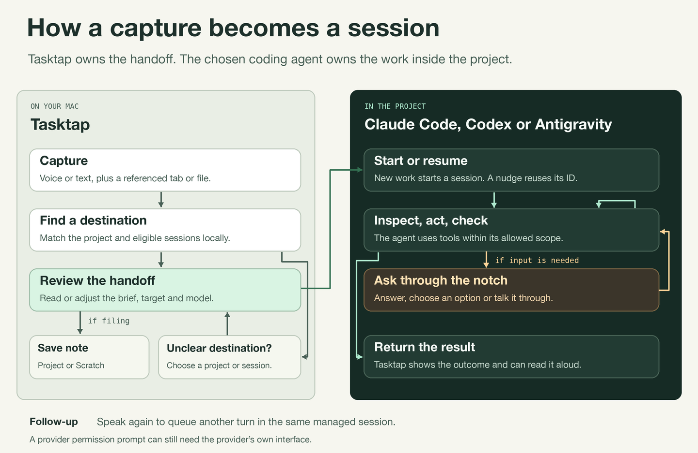

# Who runs Tasktap, and who pays?

**Architecture review · 14 November 2026 · Tasktap at `a813a28`**

This report is historical evidence for the revision named above, not a current setup guide. Tasktap now has configurable preparation connections, an embedded terminal workspace, and a single Reply action that returns typed or spoken intent to the agent. For current behavior and account choices, see [Agents, accounts, and other applications](../README.md#agents-accounts-and-other-applications) and the [question protocol](agent-questions.md).

Today you can dictate a note without a paid AI account, or hand a task to the copy of Codex, Claude Code or Antigravity already signed in on your Mac. Tasktap does the routing locally. Your chosen coding agent handles the project work and charges its own account. You can use different providers for these two jobs. [Tasktap implementation](https://github.com/HarzerHeribert/Tasktap/blob/a813a28/README.md#how-it-works)

**My recommendation** is to keep the local router as the default, offer **Continue with ChatGPT** for users who want a stronger router, and keep Claude Code, Codex and Antigravity as independently selectable workers. For live steering and permission prompts, integrate the worker’s native protocol. None of this requires installing global hooks.

## From voice to a completed turn

Take “Tell the session working on lighting to check the reflections on this page.” Tasktap can resolve the active tab in a supported browser and show the URL. If two eligible sessions match “lighting,” you choose one. The review can then fit on one card with the project, agent, brief and page. Confirming queues the new instruction for the chosen conversation. The worker keeps its model and existing context. If it asks what you meant by reflections, the notch can carry the exchange back to that session. A discussion message leaves the decision open. [Routing and review](../prototype/app.js) · [Foreground reference](../native/ScreenContext.swift) · [Question protocol](agent-questions.md)

## Sign-in and billing options

An **access token** is a credential proving who authorized a request. **Model tokens** measure the text or other input and output a model processes. A subscription covers eligible use up to its limits. An API account meters requests against its balance or agreed billing. Tasktap currently has no balance, account system or API key entry screen. Consider a Claude task routed locally. Only Claude uses a cloud allowance. If you opt into a ChatGPT router for the same task, interpreting the capture can consume ChatGPT allowance, then doing the work can consume Claude allowance. A single spoken request can therefore involve two accounts.

| Path | What the user actually does | What pays |
| --- | --- | --- |
| Local capture, routing and notes · available | Use Apple dictation or type. For some requests Tasktap uses Apple’s on-device Foundation Models when available. Local matching handles the fallback. Local narration can use an available Siri voice or installed Kokoro. | No cloud inference charge for these steps. [Tasktap’s local paths](https://github.com/HarzerHeribert/Tasktap/blob/a813a28/README.md#how-it-works) |
| Codex worker · available | Run `codex login`, choose the ChatGPT account, then choose Codex in Tasktap. The CLI can also be configured with a platform API key. `codex login status` lets you check the CLI connection yourself. | Eligible ChatGPT plan allowance with ChatGPT sign-in, or API usage with an API key. Codex owns this login. [Codex authentication](https://learn.chatgpt.com/docs/auth) |
| Claude Code worker · available | Run `claude auth login` through Anthropic’s flow and select the account. Check it with `claude auth status`. Tasktap launches the installed binary. Console and supported cloud configurations also work through that binary. | A plan-authenticated `claude -p` can use subscription limits. A configured API key can take precedence over a saved plan login in headless mode. Check the credentials available to the app’s process when billing matters. [Headless billing](https://support.claude.com/en/articles/15036540-use-the-claude-agent-sdk-with-your-claude-plan) · [Credential precedence](https://code.claude.com/docs/en/authentication#authentication-precedence) |
| Antigravity worker · available | Sign in interactively with `agy`. Tasktap launches `agy acp`, which reuses Google’s cached login. Google also supports a configured Gemini API key or Google Cloud Application Default Credentials. | The selected Google account, key or Cloud project supplies access and applicable limits. [Google ACP authentication](https://antigravity.google/docs/ide/extensions/acp/#authentication) |
| Continue with ChatGPT for Tasktap’s own assistant · possible addition | The native app opens the browser. The user selects an account and workspace, then separately consents to eligible model use. Tasktap checks the granted inference scope and keeps its own connection in the Mac Keychain. | An eligible user’s ChatGPT plan can cover supported Responses calls. OpenAI identifies Plus and Pro users for its local/open-source path. Account identity alone grants no inference or access to chat history. [OpenAI’s integration guide](https://developers.openai.com/cookbook/articles/sign-in-with-chatgpt) · [Consent flow](https://developers.openai.com/siwc/token-sharing-open-source/sign-in) |
| Tasktap assistant with the user’s API credentials · possible addition | Connect an OpenAI Platform or Anthropic Console key, or a supported enterprise provider. Show which account is selected before sending the first remote capture. | Direct API billing. Eligible users can claim separate linked-organization credits. OpenAI’s subscriber API-credit benefit excludes **Codex runs billed through API keys**. Anthropic lists linked Console credits for eligible Max, Ultra and Team customers. [OpenAI credits](https://developers.openai.com/api/docs/guides/chatgpt-api-credits) · [Anthropic credits](https://support.claude.com/en/articles/15036540-use-the-claude-agent-sdk-with-your-claude-plan) |

**For a public release**, OpenAI documents plan sharing for open-source apps and personal local projects. Paid or remotely hosted products have a partner inquiry route. This checkout has no root license or README license statement, so choose the distribution license before advertising an open-source release. The direct integration can use locally defined tools and eligible streaming models. It requires `store: false`, context supplied by the client and a completed response. Its preview excludes audio transcription, hosted MCP and native computer use. Tasktap’s existing local dictation fits that boundary. The same consent can also power a suitably configured Codex app-server. [Distribution options](https://developers.openai.com/siwc/token-sharing-open-source) · [Preview limitations](https://developers.openai.com/siwc/token-sharing-open-source/preview-limitations) · [Codex configuration](https://developers.openai.com/siwc/token-sharing-open-source/codex-app-server)

Anthropic explicitly permits products to run its unmodified Claude Code binary under its commercial conditions. The end user authenticates directly, pays their provider, and retains the binary’s built-in sign-in choices. Its guidance for developers building their own AI features calls for Console API or supported cloud authentication and prohibits intermediating consumer credentials. I would offer **Run this in Claude Code** as a user-directed worker and use API or cloud billing for a **Claude-powered Tasktap router**. Moving an invisible request into a subprocess doesn’t change who is offering the feature. [Claude Code product and credential terms](https://code.claude.com/docs/en/legal-and-compliance)

## Could the assistant itself be headless Codex or Claude Code?

**Yes.** Run the coordinator in an app-owned directory. Give it the capture, a shortlist of candidate project and session IDs, and a schema for its final proposal. Codex offers `exec --json --output-schema`. Claude offers `-p --output-format json --json-schema`, plus a streaming output mode. An event stream drives the UI. A schema constrains the shape of a completed report. Tasktap must still handle rejection, an interrupted stream, and a perfectly formatted answer that names the wrong project. A subscription login does not change those engineering requirements. [Codex noninteractive mode](https://learn.chatgpt.com/docs/non-interactive-mode) · [Claude headless mode](https://code.claude.com/docs/en/headless)

I would give this coordinator read-only **find projects**, **find sessions** and **resolve this reference** operations. Add **read a short excerpt from a reviewed file** when a filename alone cannot resolve the request. Have it return an action, target ID, outgoing brief, evidence for the match, and a question if necessary. Tasktap checks that the target still exists and is eligible, then dispatches once on confirmation. A greeting should yield no job. Two plausible lighting sessions should yield one question. Today the router supports ask, nudge and note. A dedicated no-action result for greetings would be an addition. [Current router schema](../native/HandoffRouter.swift) · [Current destination checks](../prototype/live.js)

Use a hook only for a specific lifecycle event that lacks a suitable provider API. Ordinary headless Claude Code can load a project’s hooks and MCP configuration, even in a previously untrusted directory. This is another reason to run a coordinator outside candidate projects. Claude’s `--bare` skips those customizations and also skips subscription credentials in the keychain. For the worker itself, Codex app-server is the most valuable next adapter here. It exposes tool events, native approvals, and `turn/steer` addressed to a particular active turn. Today Tasktap’s managed nudges wait for the current turn to finish. [Claude headless behavior](https://code.claude.com/docs/en/headless) · [Codex app-server](https://learn.chatgpt.com/docs/app-server)

## What each part can see and do

| Component today | Available tools or signals | Practical limit |
| --- | --- | --- |
| Local router | Receives capture text, project names and nudgeable session labels. Apple can stream a draft brief and estimate difficulty. | No callable filesystem, shell or browser tools. The input is capped at 9,000 capture characters, 80 project names and 45 session labels. A difficulty estimate uses the request, before code inspection. [Router input](../prototype/live.js) · [Apple model call](../native/HandoffRouter.swift) |
| Native Mac app | Remembers the source app at capture, resolves a supported browser’s active URL, a selected Finder file or an accessible document URL. Shows the reference for correction or removal. Saves notes, opens results and surfaces questions. | The attached context is a URL or path with provenance. Page contents, selected text, screenshots, unsaved editor buffers and the browser’s authenticated state are outside the current capture. [Mac context](../native/ScreenContext.swift) · [Handoff attachment](../prototype/context.js) |
| Managed worker | Runs the named CLI in the confirmed folder. The provider supplies its own read, edit, shell and configured tools. Tasktap adds one scoped MCP tool, `ask_user`, per managed run. | A working directory selects the starting point. Effective permissions come from the CLI sandbox, configuration and macOS. Fresh Codex asks for `workspace-write`; its resume path does not pass that flag explicitly. Claude’s auto-approval for `ask_user` does not restrict its other built-ins. [Worker launch](../scripts/run-agent) · [Decision tool](../scripts/agent-tools) |
| Activity and decisions | Managed sessions record queue state, provider conversation ID, outcome or failure. Antigravity forwards supported one-time permission choices. Other managed agents can ask product questions through `ask_user`. | Permission to execute a command is distinct from a design decision. Today Claude/Codex native permission prompts can require the provider’s own interface. A cmux inbox receipt confirms delivery only. External Claude terminals and locally indexed Codex desktop chats provide limited observation. A general ChatGPT conversation has no automatic reply channel here. [Discovery matrix](https://github.com/HarzerHeribert/Tasktap/blob/a813a28/README.md#what-tasktap-can-observe-without-installing-hooks) · [Antigravity permissions](../scripts/agy_session.py) |

For “this website looks wrong,” the Mac app can identify **which tab**. A worker can then find the corresponding source in the chosen project, run an allowed development command or tests, and inspect the output. To verify the **rendered page**, it needs an available browser or preview tool and access to that page. Starting a new server, reading an authenticated tab, and sending a screenshot are separate capabilities. A useful addition would be a one-shot **Attach this preview** action showing the exact image or excerpt about to leave the Mac.

Cloud routing would also move the moment data leaves the Mac. A remote router must see some capture text **before** it can draft the review. I would make that clear when the user turns it on, shortlist candidates locally, and send only the relevant labels. Keep file excerpts and page contents behind a separate attachment choice. The later **Start session** confirmation then has one clear meaning: send this reviewed job to this worker.

## The prompt a worker actually gets

Tasktap already writes the outgoing instruction. A fresh job contains the reviewed brief, any reviewed URL or file metadata, and any sketch as ordered coordinates. The runner adds a short instruction to use `ask_user` for decisions, distinguish discussion from an answer, and report the outcome and changed files. For Claude this is appended to its system prompt. For Codex and Antigravity it precedes the user brief. A managed nudge uses the saved conversation ID. Difficulty-based model choice applies to fresh work. [Worker prompt construction](../scripts/run-agent) · [Model selection](../prototype/model-policy.js)

Both providers’ current prompting guidance points to the same product design. Preserve the outcome, relevant context, constraints and any observable success condition the person actually supplied. Let the coding agent discover implementation details. For a nudge, send only what changed. Two examples of briefs I’d want to see in Tasktap’s review follow. [OpenAI’s Codex prompting guide](https://learn.chatgpt.com/docs/prompting#prompting-codex) · [Anthropic’s prompting guidance](https://code.claude.com/docs/en/best-practices#write-a-specific-prompt)

| User’s capture | Reviewable handoff |
| --- | --- |
| “In Glasshouse, figure out why the floor reflection goes black when I rotate the light. Just explain it for now.” | **Start in Glasshouse** · “Find what makes the floor reflection turn black when the light rotates. Explain the cause. Leave the code unchanged.” |
| “Tell the lighting session to check reflections on this page too.” | **Nudge the existing lighting session** · “Also check the reflections on the attached page.” Include the reviewed URL. Keep the existing model. |

For live feedback, show facts the app can substantiate: the tab it resolved, the sessions it matched, the current draft, whether the worker accepted a turn, and what verification the worker reports. Keep these visible when narration is muted. A model’s private reasoning is unavailable as a reliable audit trail. The useful audit trail is the **exact outgoing brief, selected destination, actual tool events and result**.

## Decisions that change the product

| Question | Suggested default |
| --- | --- |
| Does every ramble consume a cloud allowance? | Local first. Offer an explicit stronger-router setting and show which account pays. On quota exhaustion, offer local routing, waiting or an explicit billing switch. |
| Does finding a project require a worker with shell access? | Start with the local catalog. Let the user authorize a small extra lookup when the available evidence is ambiguous. Start the worker only after review. |
| What would make a nudge feel live? | Use Codex app-server for active-turn steering and typed approvals. Continue to show **Queued** on adapters that deliver between turns and **Delivered** for an external inbox. |
| Can I veto a rewrite before the agent acts? | Keep a single concise handoff card. Offer the original capture and exact outgoing brief on demand. Resolve ambiguous targets before the send button can dispatch. |

**Verification.** Three parallel investigations covered the checkout, provider authentication and the headless protocols. The offline worker-model and UI routing-policy suites passed. Installed CLI help was checked for Codex 0.167.0, Claude Code 2.1.325 and Antigravity 1.5.9. Personal account state, available quota and a billable end-to-end turn were outside this review.
